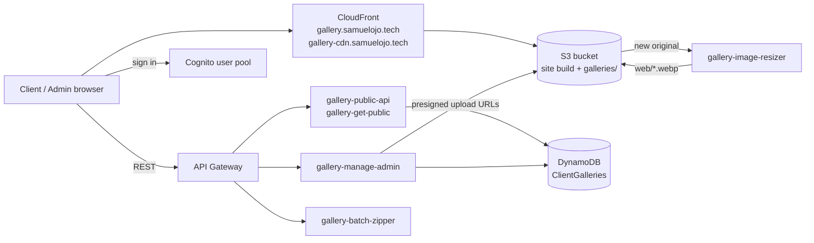

# Client Gallery

A serverless photo-delivery platform for **Samuel Ojo Photography**, live at **[gallery.samuelojo.tech](https://gallery.samuelojo.tech)**.

Clients open a private link (or enter a PIN) to view their gallery as fast, compressed web images and download the full-resolution originals, individually or as a zip. The photographer signs in to upload new galleries, choose whether each is public, and get a shareable link and PIN.

## Architecture



| Layer | Service | Notes |
|---|---|---|
| Frontend | React 19 + TypeScript + Vite + Tailwind | Single-page app in [`gallery-frontend/`](gallery-frontend) |
| Hosting / CDN | S3 + CloudFront (us-east-1) | One distribution serves the app and the gallery images |
| Auth | Amazon Cognito via AWS Amplify | Admin sign-in only; clients use link + PIN |
| API | API Gateway + Lambda | Public gallery listing, PIN verification, admin create, zip download |
| Data | DynamoDB `ClientGalleries` | One item per gallery (title, client, PIN, image list, public flag) |
| Images | S3 `galleries/<id>/originals/` → Lambda → `galleries/<id>/web/*.webp` | Originals uploaded straight to S3 with presigned URLs; the resizer creates web versions |

> The Lambda functions, API Gateway, DynamoDB table and Cognito pool are not in this repository yet — they were created manually in the AWS console. This repo contains the frontend and its CI/CD pipeline.

### App routes

| Route | Page |
|---|---|
| `/` | Landing page: public galleries, PIN entry, and admin sign-in / upload |
| `/g/:id` | A single gallery (PIN-protected unless public), with downloads |
| anything else | Redirects to `/` (CloudFront also maps 403/404 to `index.html`) |

## Repository layout

```
.
├── .github/
│   ├── workflows/deploy.yml   # CI/CD pipeline
│   └── dependabot.yml         # Weekly dependency + action updates
├── gallery-frontend/          # React app (src/, vite.config.ts, package.json)
└── index.html                 # Simple static landing page
```

## Local development

Requires Node.js 22+.

```bash
cd gallery-frontend
npm ci
```

Create `gallery-frontend/.env.local` (git-ignored) with:

```
VITE_API_BASE_URL=https://<api-id>.execute-api.us-east-1.amazonaws.com
VITE_CDN_URL=https://gallery-cdn.samuelojo.tech
VITE_COGNITO_USER_POOL_ID=us-east-1_xxxxxxxxx
VITE_COGNITO_CLIENT_ID=xxxxxxxxxxxxxxxxxxxxxxxxxx
```

Then:

```bash
npm run dev      # local dev server
npm run lint     # ESLint
npx tsc --noEmit # type check
npm run build    # production build into dist/
```

## CI/CD pipeline

Defined in [`.github/workflows/deploy.yml`](.github/workflows/deploy.yml). Runs on every push and pull request to `main`, and can be started manually.

```
push / PR / manual
        │
        ▼
┌─ Stage 1: Quality Gates & Build (every run) ─────────────────────────┐
│ npm ci → audit prod deps (high) → tsc --noEmit → eslint → vite build │
│ → upload dist/ as a build artifact                                   │
└──────────────────────────────────────────────────────────────────────┘
        │ only on main (push / manual), never on PRs
        ▼
┌─ Stage 2: Deploy (one at a time) ────────────────────────────────────┐
│ download the same dist/ → assume AWS role via OIDC (no stored keys)  │
│ → upload assets/ → upload other files → upload index.html            │
│ → remove stale files → invalidate CloudFront → wait                  │
│ → smoke test: live site must serve the new bundle                    │
└──────────────────────────────────────────────────────────────────────┘
```

Key properties:

- **Keyless AWS auth** — GitHub OIDC assumes `GitHubActionsGalleryRole`; only the deploy job can request a token.
- **Build once, deploy what was tested** — the artifact that passed the gates is the one uploaded.
- **Client photos are never touched** — every S3 sync excludes `galleries/`.
- **No broken window during deploys** — new hashed assets go up before `index.html` points at them; old files are deleted last.
- **Caching** — `assets/*` are `immutable` (1 year), `index.html` is `no-cache`, other static files cache for 1 hour.
- **Deploys can't overlap** — a `concurrency` group queues a second deploy behind the first.
- **Post-deploy check** — the run fails if the live site isn't serving the new bundle.
- **Pinned actions** — every action is pinned to a commit SHA; Dependabot keeps them current.

### Configuration

Set in **GitHub → Settings → Secrets and variables → Actions**:

| Name | Type | Purpose |
|---|---|---|
| `VITE_API_BASE_URL` | Variable | API Gateway base URL |
| `VITE_CDN_URL` | Variable | Image CDN URL |
| `VITE_COGNITO_USER_POOL_ID` | Variable | Cognito user pool |
| `VITE_COGNITO_CLIENT_ID` | Variable | Cognito app client |
| `CLOUDFRONT_DIST_ID` | Secret (optional) | Overrides the default distribution ID |

## Dependency updates

Dependabot ([`.github/dependabot.yml`](.github/dependabot.yml)) opens weekly PRs:

- **npm** (`gallery-frontend/`) — minor and patch updates are grouped into one PR; major updates get their own PR.
- **GitHub Actions** — bumps the pinned SHAs in `deploy.yml`.

TypeScript major updates are ignored for now: `typescript-eslint` 8.x supports TypeScript `<6.1`, so TypeScript 7 can't be installed alongside it. Remove the `ignore` rule once `typescript-eslint` supports TypeScript 7.

## Changelog

### 2026-11-09 — Pipeline hardening

**Fixed: deploys deleted client galleries.** The deploy step ran `aws s3 sync dist/ s3://… --delete`. Client photos live in the same bucket under `galleries/`, and they aren't in `dist/`, so every push to `main` would have deleted every gallery. All syncs now exclude `galleries/*`. Verified with a probe file in the live bucket, and in practice: a gallery uploaded minutes before a deploy survived it.

**Fixed: deploys blocked by dependency audit.** New high-severity advisories (vite, zod, source-map-js, `@typescript-eslint`) failed the audit gate. Resolved with a non-breaking `npm audit fix` (lockfile only), after which all gates passed and the site redeployed.

**Pipeline overhaul** (`deploy.yml`):

| Before | After |
|---|---|
| Node 20 (end of life) | Node 22 |
| `npm audit` on all deps blocked deploys over dev-only tools | Audits production deps only; dev-tool advisories arrive as Dependabot PRs |
| Installed and built twice; deployed a different build from the one checked | Builds once and deploys that artifact |
| Two pushes could deploy at the same time | `concurrency` group serializes deploys |
| No cache headers | Immutable hashed assets, `no-cache` `index.html` |
| Single sync with `--delete` | Ordered upload (assets → index → cleanup) with no broken window |
| No check after deploy | Waits for CloudFront, then smoke-tests the live bundle |
| AWS region `eu-west-2` (bucket is in `us-east-1`) | `us-east-1` |
| Actions on floating `@v4` tags | Latest releases pinned to commit SHAs |
| OIDC token permission on every job, including PR checks | Only the deploy job can request AWS credentials |

**Added:** Dependabot for npm and GitHub Actions, with the TypeScript 7 major update ignored (see above).

## Roadmap

- Put the backend (Lambdas, API Gateway, DynamoDB, Cognito) in infrastructure-as-code with its own pipeline.
- Move client uploads to a dedicated bucket so frontend deploys and client photos are fully separate.
- Turn on point-in-time recovery for the `ClientGalleries` table.
- Add tests (unit + an end-to-end PIN/gallery flow) as a pipeline gate.
- Tighten the IAM trust policy's `sub` condition to `repo:SamuelMojo/Client-Gallery:ref:refs/heads/main`.
- Migrate Tailwind 3 → 4.
