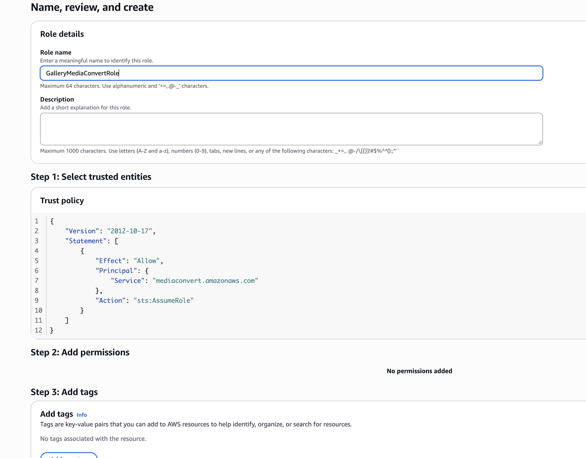

# Backend: photo + video uploads

Lambda source for the video-upload update. These functions were created by hand in the AWS console,
so **deploying means pasting `index.mjs` into the function and clicking Deploy**. Nothing here is
deployed by CI.

| Folder | Function | What changed |
|---|---|---|
| `gallery-manage-admin/` | `POST /admin/galleries` | Allowlist of file types and sizes; signs content type, exact length and download header; unique keys; video fields in DynamoDB; no PIN-less overwrite |
| `gallery-image-resizer/` | S3 trigger | Routes by type: photos → sharp, videos → MediaConvert job, RAW → skipped |
| `gallery-video-status/` | **new**, EventBridge | Marks a video `ready` / `failed` when its MediaConvert job finishes |
| `gallery-delete-admin/` | **new**, `DELETE /admin/galleries/{galleryId}` | Admin-only: deletes a gallery's files from S3, then its DynamoDB record |
| `gallery-batch-zipper/` | Function URL | Leaves videos out of the ZIP, fetches files one at a time, zip64 for big galleries |

## Rollout order

The old frontend still works with the new `gallery-manage-admin`, and the new frontend still works with the old one,
so these can go out in any order. Recommended: backend first, then merge the frontend PR.

### 0. Activate MediaConvert (first time only)

A new account must open the **AWS Elemental MediaConvert** console once (region us-east-1) and complete its first-time
prompts before it will accept jobs. Until then, job creation fails with
`SubscriptionRequiredException: The AWS Access Key Id needs a subscription for the service`.

This also happens on the **Free account plan**, which cannot use every AWS service. Upgrade to the Paid plan
(as the root user; an IAM user may not be allowed to) if the error persists after opening the console.

### 1. MediaConvert service role

IAM → Roles → Create role → *Custom trust policy*, name `GalleryMediaConvertRole`.

Trust policy:

```json
{
  "Version": "2012-10-17",
  "Statement": [{
    "Effect": "Allow",
    "Principal": { "Service": "mediaconvert.amazonaws.com" },
    "Action": "sts:AssumeRole"
  }]
}
```

Inline permissions policy:

```json
{
  "Version": "2012-10-17",
  "Statement": [
    {
      "Effect": "Allow",
      "Action": "s3:GetObject",
      "Resource": "arn:aws:s3:::samuelojo-client-gallery-2026/galleries/*/originals/*"
    },
    {
      "Effect": "Allow",
      "Action": "s3:PutObject",
      "Resource": "arn:aws:s3:::samuelojo-client-gallery-2026/galleries/*/web/*"
    }
  ]
}
```

Copy the role ARN.

Review page as created (trust policy for `mediaconvert.amazonaws.com`, no managed policies; the S3 access is the inline policy added afterwards):



### 2. `gallery-image-resizer`

1. Paste `gallery-image-resizer/index.mjs` and Deploy.
2. Configuration → Environment variables: `MEDIACONVERT_ROLE_ARN` = the role ARN from step 1.
3. Configuration → General: memory **1536 MB or more**, timeout **60 s or more** (TIFF and large photos decode in memory).
4. Add this to the function's execution role (inline policy). Replace `<ACCOUNT_ID>`:

```json
{
  "Version": "2012-10-17",
  "Statement": [
    { "Effect": "Allow", "Action": "mediaconvert:CreateJob", "Resource": "*" },
    {
      "Effect": "Allow",
      "Action": "iam:PassRole",
      "Resource": "arn:aws:iam::<ACCOUNT_ID>:role/GalleryMediaConvertRole",
      "Condition": { "StringEquals": { "iam:PassedToService": "mediaconvert.amazonaws.com" } }
    }
  ]
}
```

The Node 20/22 Lambda runtime already includes `@aws-sdk/client-mediaconvert`. If the function bundles its own SDK, add it.

The existing S3 trigger can stay as it is. The code ignores anything outside `/originals/`,
so MediaConvert's outputs in `/web/` do not loop.

### 3. `gallery-video-status` (new function)

1. Create function `gallery-video-status`, Node 22, paste `index.mjs`.
2. Env var `TABLE_NAME` = `ClientGalleries`.
3. Execution role: `dynamodb:GetItem` and `dynamodb:UpdateItem` on the `ClientGalleries` table.
4. EventBridge → Rules → Create rule (default bus), target = this function, event pattern:

```json
{
  "source": ["aws.mediaconvert"],
  "detail-type": ["MediaConvert Job State Change"],
  "detail": {
    "status": ["COMPLETE", "ERROR"],
    "userMetadata": { "app": ["client-gallery"] }
  }
}
```

### 4. `gallery-manage-admin`

Paste `gallery-manage-admin/index.mjs` and Deploy. No new permissions are needed.
Presigned URLs now last 1 hour (was 15 minutes) so large videos can finish uploading.

### 5. `gallery-batch-zipper`

Paste `gallery-batch-zipper/index.mjs` and Deploy. Confirm the function timeout is the maximum (15 min).

### 6. `gallery-delete-admin` (new function, admin "Delete Gallery" button)

**Deleting is permanent.** Before relying on it, consider turning on DynamoDB point-in-time recovery for
`ClientGalleries` and S3 versioning on the bucket (deletes then leave recoverable versions). Neither is on today.

1. Create function `gallery-delete-admin`, Node 22, paste `gallery-delete-admin/index.mjs`. Timeout **1 min**, memory 256 MB.
2. Execution role inline policy (name it `GalleryDeleteAdmin`):

```json
{
  "Version": "2012-10-17",
  "Statement": [
    {
      "Effect": "Allow",
      "Action": "s3:ListBucket",
      "Resource": "arn:aws:s3:::samuelojo-client-gallery-2026",
      "Condition": { "StringLike": { "s3:prefix": "galleries/*" } }
    },
    {
      "Effect": "Allow",
      "Action": "s3:DeleteObject",
      "Resource": "arn:aws:s3:::samuelojo-client-gallery-2026/galleries/*"
    },
    {
      "Effect": "Allow",
      "Action": "dynamodb:DeleteItem",
      "Resource": "arn:aws:dynamodb:us-east-1:094813111563:table/ClientGalleries"
    }
  ]
}
```

3. API Gateway → your API → **Routes → Create**: `DELETE /admin/galleries/{galleryId}`.
   - Attach the **same JWT authorizer** that `POST /admin/galleries` uses.
   - Integration: the `gallery-delete-admin` Lambda.
   - **CORS**: make sure `DELETE` is in the allowed methods and `Authorization` in the allowed headers.
   - Deploy the stage if it does not auto-deploy.
4. The function also rejects any request without a verified token (401) and any id that is not a UUID (400),
   so a misconfigured route cannot become an open delete.

### 7. Frontend

Merge the `feature/video-uploads` PR. The pipeline builds and deploys it.

## Test checklist

Use a throwaway gallery.

1. **Regression:** upload 2 JPEGs and 1 PNG. Web previews appear, Download Original works, ZIP works.
2. **Short MP4** (about 10 s). Tile shows "Processing…", then a poster and play icon. Playback works and seeks.
3. **iPhone MOV** (HEVC). Plays in Chrome and Firefox as well as Safari.
4. **Check the MediaConvert output names** in S3 under `galleries/<id>/web/`. The code expects
   `<name>_web.mp4` and `<name>_poster.0000000.jpg`. If the poster name differs, change `posterKey`
   in `gallery-manage-admin` to match.
5. **RAW (ARW):** uploads, shows an "ARW" placeholder tile, Download Original works.
6. **HEIC:** uploads. A web preview appears only if your `sharp` build can decode HEIC; otherwise the tile shows "No preview".
7. **Gallery with a video:** the button reads "Download Photos (ZIP)" and the ZIP has no video.
8. **Rejected types:** try an `.svg` or `.exe`. The form refuses it, and a direct API call returns 400.
9. **Delete (use a throwaway gallery):** signed in, open it, click **Delete Gallery**, type its title, confirm.
   You land on the home page, the gallery is gone from the list, `/g/<id>` says "Gallery not found", and
   `galleries/<id>/` is empty in S3. Signed out, no Delete button appears, and a direct
   `curl -X DELETE <api>/admin/galleries/<id>` returns 401.

## Known limits

- Video previews keep the source resolution (capped at 8 Mbps), they are not scaled down to 1080p.
- A video preview is ready a minute or more after upload, longer for long clips.
- Single-PUT uploads are limited to 5 GB and are not resumable. Multipart upload is the next step if that bites.
- The 15-minute presigned URL window was widened to 1 hour; very slow connections with multi-GB files may still need more.
